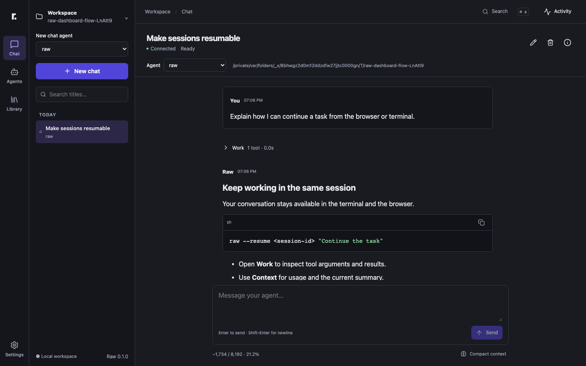
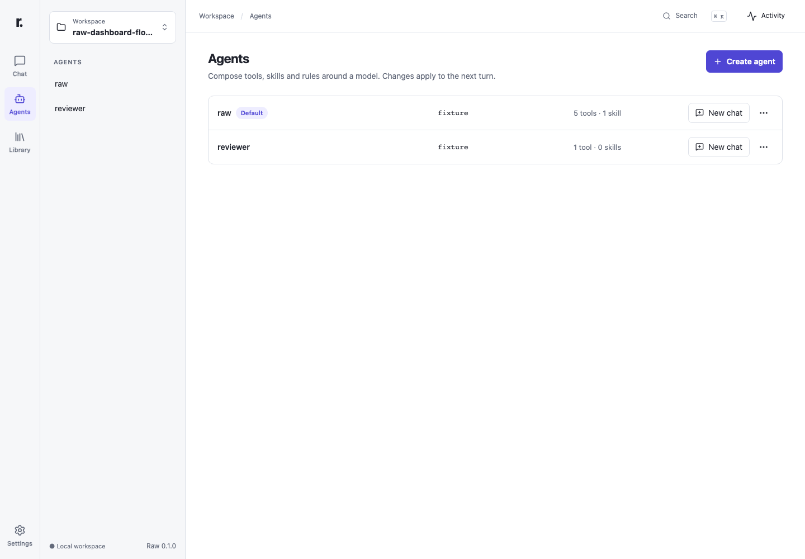
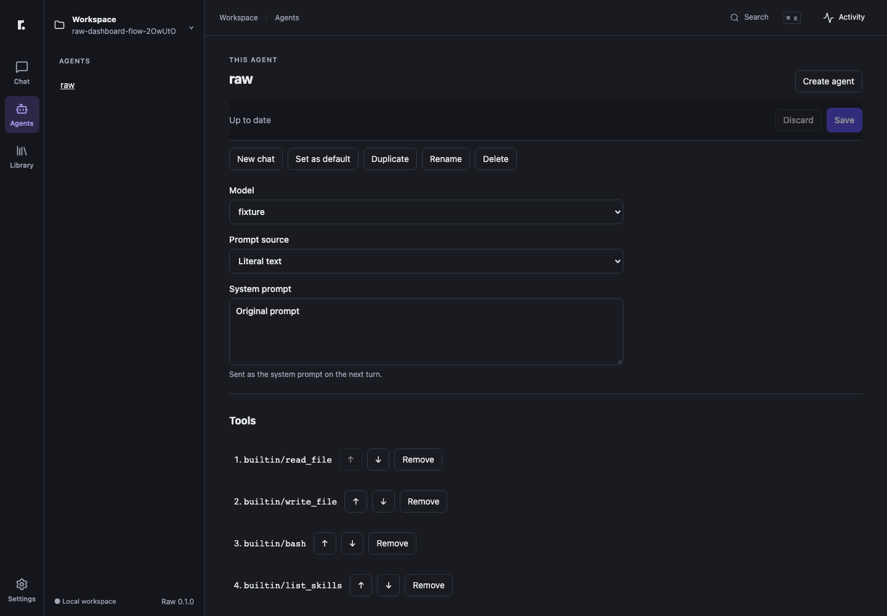
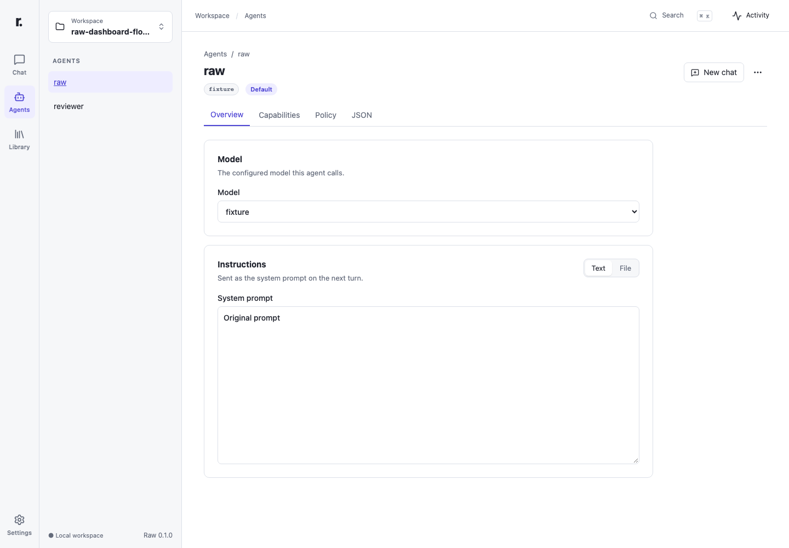
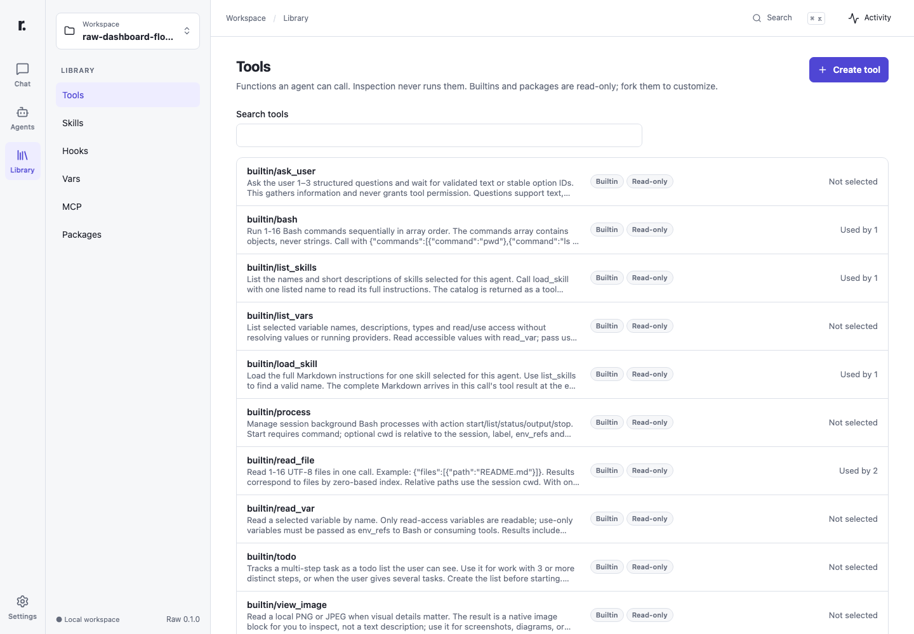
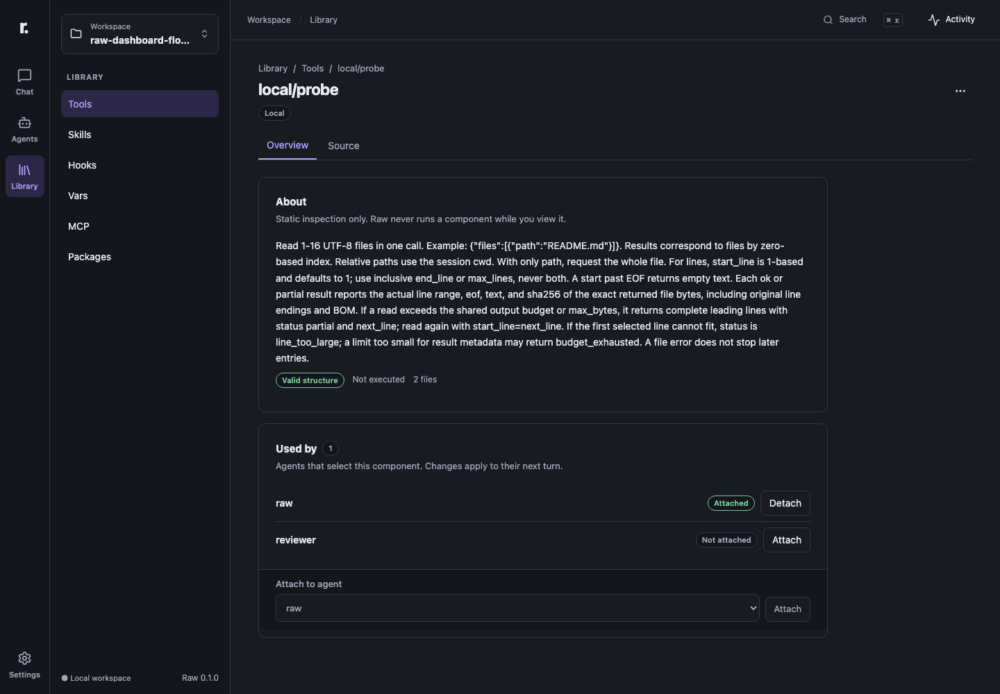
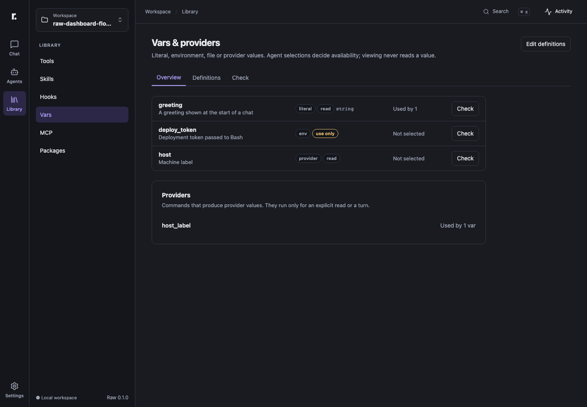
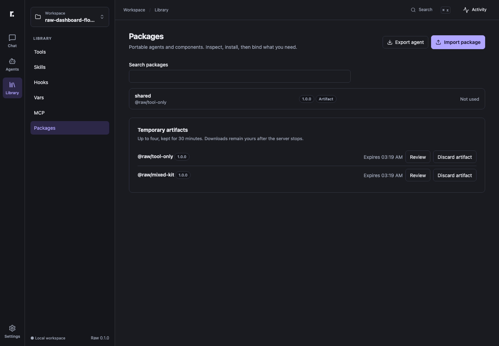
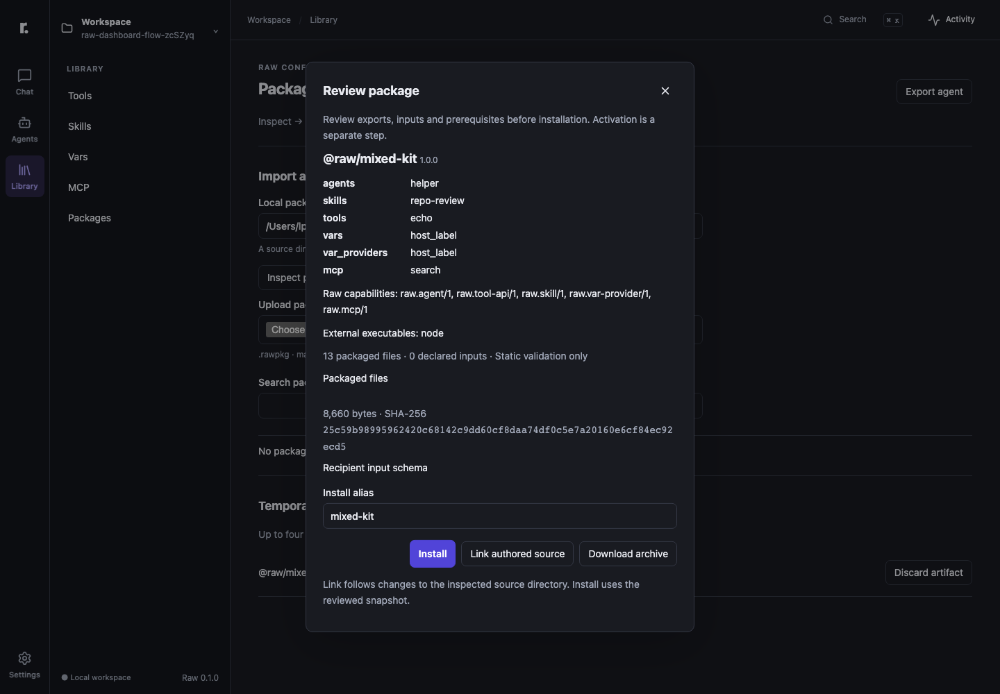

# Local dashboard

Run `raw dashboard` from the project you want to work on. Raw starts a foreground server at `http://127.0.0.1:8787` and opens your browser when launched interactively. It prints an authenticated launch link. Keep this process running while using the dashboard; Ctrl-C closes its operations, connections and session ownership.

```sh
raw dashboard
raw dashboard --port 0 --no-open
raw dashboard --config /path/to/raw.json --agent deepseek
```

`--port 0` chooses a free port. An occupied port is an error; Raw never terminates another listener or silently attaches to it. `--no-open`, SSH and noninteractive launches leave a usable printed link. Browser opening failure does not terminate a healthy server.

One dashboard manages one displayed config file. The invoking directory is its initial workspace. A workspace changes relative runtime paths, not OS filesystem permissions. Missing credentials or missing/invalid config do not prevent the setup/repair interface from loading. No model, tool or MCP connection starts just to display the application.

The launch token is in the URL fragment. The browser keeps it in tab session storage, removes the fragment from the address bar and authenticates API/stream requests through an Authorization header. A server restart creates a new token; reopen the new launch link. Do not publish a launch link to others. The server binds only IPv4 loopback and does not provide accounts, LAN sharing or a public listener.

Browser tabs observe server-owned operations. Closing or refreshing a tab does not cancel a run. Stop cancels an operation explicitly. CLI and browser use the same saved sessions; a session executing in another process remains readable, and becomes runnable in the dashboard after its writer releases it.

See [session operations](sessions.md), [management](management.md) and the [dashboard API](dashboard-api.md) for persistence, configuration authority and transport contracts.

## Chat workspace

The rail, the workspace sidebar and the side panel sit on a darker backdrop, and the page you are on is one rounded card between them; no rules divide the screen ([chat-design.md](chat-design.md) §3). Below 600 px the card fills the window. On a chat the card starts with a single header row (the title, the agent, the workspace path as `~/…` under your home directory, Quick navigation, Activity, Side panel and More actions) in place of the toolbar the other pages show ([chat-design.md](chat-design.md) §4).

Selected agent hooks appear in the conversation history as compact receipts showing the hook ID, event and outcome. A successful hook is visible even when its command writes no stdout. Hook messages are host status, never assistant text sent to the model. See [hooks](hooks.md) for events, filters and cancellation behavior.

The workspace button in the sidebar opens the **workspace switcher**. It lists the current workspace (checked), your **Pinned** workspaces and **Recent** ones, each with its folder name, a shortened path (`~/projects/app`), the number of chats, when it was last used and a `Running` badge while a chat there is working. Type in the filter to narrow the list by name or path; use the arrow keys and Enter to choose, Escape to close. Each row has a pin button and a **More actions** menu with **Copy path** and **Remove from recent**; removing only hides the entry in this browser and never deletes chats or files. A workspace whose folder no longer exists is marked `Missing`: it cannot be chosen, but it can be removed and never blocks the others. A folder you choose joins Recent immediately, even before it has a chat. Pins, removals and opened folders are remembered by this browser only (not in the config or the session store). **Open folder…** at the bottom opens a folder browser: type a path in **Workspace directory** (Enter or Go lists it), click a folder to go into it, use the Up button for the parent, filter the list, or turn on **Show hidden folders** (it resets each time the dialog opens). Symbolic links to folders carry a link mark. The browser is a read-only listing of folders only: it never shows files and never creates, renames or deletes anything, and choosing a workspace changes relative paths, not OS permissions. **Open this folder** validates the path in the field on the server and switches to it; if the folder cannot be listed or has disappeared, the error stays in the dialog and you can keep typing. If browsing fails altogether, typing a valid path and pressing Open still works. Existing chats keep the workspace they were created in.

Choose a workspace and agent, then create a chat. Enter sends; Shift-Enter adds a line. The Chat browser preference can require Ctrl/Cmd-Enter instead. Composition input is never sent before the IME confirms it. Drafts stay in memory when navigating between sessions. No inference starts until Send. Your message shows in the conversation the moment you send it, marked **Sending…** and then **Waiting for the agent** until the agent receives it; when a hook denies it, the agent fails to start or you stop it first, the bubble says **Not delivered** with the reason, **Retry** and **Edit** ([chat-design.md](chat-design.md) §5).

The message box grows with its content up to about eight lines, then scrolls. Send is the round button at the right of the toolbar below it, and a hint under the composer says how to send ([chat-design.md](chat-design.md) §8). While your operation runs the button is Stop when the box is empty.

You can send while the agent works. Enter (or Ctrl/Cmd-Enter with that preference) queues the message: it waits as a card above the composer marked **Sends after the current step**, and the agent gets it after the step it is on (a tool call, or the answer it is writing), in the same turn; your bubble then shows where it got it. **Interrupt and send** in the menu beside Send, or Ctrl/Cmd-Shift-Enter, stops the current step instead (a finished tool result is kept, a partial answer is dropped) and starts a turn with the message. Each card has **Edit** (the message, its files and images go back into the box, before what you typed), **Delete** and **Send now**; Up in an empty box edits the last one. Stop, or an error, pauses waiting messages (**Paused**) until you press Send now; a message a hook refused says **Blocked** with the hook's reason. The queue is kept by the server, so it survives a reload and shows in every tab; a message deleted or edited after the agent took it says **Already sent**. Messages queued when a turn finishes start the next turn. Next to Send, a ring shows how much of the context is used (against the auto-compact trigger when the agent sets one, else the model's window; amber from 80 %, red from 95 %). Click it for the Context card: the tokens (`~` when estimated), the messages kept and the trigger, **Compact now**, and **Details**, which opens the side panel's Details tab. Typing `/` at the start of the message opens a command list above the box: `↑`/`↓` move, `Enter` or `Tab` select, `Esc` closes, and focus never leaves the message box. Built-in commands: `/compact` (summarize model context; disabled with a reason while work is running), `/rename`, `/new` and `/details` (show or hide the side panel). The selected agent's skills are listed too; choosing one inserts `Use the skill "<name>" for this task. ` into the message for you to complete. While the list is open, Enter selects instead of sending; text that matches nothing, such as `/unknown`, is sent as written.

Use the `+` button for **Upload image…**, **Reference workspace file…** (inserts `@`) or **Commands** (inserts `/`). Images can also be pasted or dropped on the composer ("Drop to attach"). Each attachment appears as a chip above the message box: uploading (Send waits), ready, or an error with Retry and Remove. A chip error (unsupported type, too large, expired) affects only that chip and never blocks the text turn; failed chips are not sent. Typing `@` at the start of a word searches workspace files; choosing one adds a file chip instead of leaving text behind. An attachment-only turn sends a default line (`Please look at the attached image.`). Sent images show as thumbnails in the conversation (click to enlarge) and load again after a reload. When the selected agent cannot read images, its chips carry a warning and the note "Images in this chat are sent to this agent as text placeholders." appears; nothing is blocked.

The composer can send images and workspace file references with a turn. Images are uploaded first, staged for 30 minutes and consumed only when the turn is accepted; a rejected upload never removes other attachments or your text. Files are referenced by workspace-relative path and cannot leave the workspace. An agent whose model lacks vision still accepts image turns: it receives a text placeholder and the original image stays in the saved chat. See `dashboard-api.md` for the routes, limits and errors; `dashboard-composer-design.md` records the design.

A pill in the toolbar, after `+`, sets the reasoning level and service tier for the next turn. Its label comes from the agent's provider (Anthropic "Effort", OpenAI and DeepSeek "Reasoning", Google "Thinking"), and it is absent when the provider has no such settings. It reads `Reasoning: default` at the agent's own setting, `Reasoning: high` for a level, and adds ` · priority` for a non-default service tier. Click it to open a stepped slider (leading **Agent default**, then each level; ←/→/↑/↓ move, Home returns to Agent default, Esc closes) and a service tier list with cost and speed hints; Reset restores both. The choice applies per turn, is never written to the agent's configuration, and is remembered for this chat in the browser tab. Nothing is guessed about what the model supports: the chosen value is sent, a provider that rejects it fails only that turn (shown in the conversation), and Agent default is always one click away.

History is chronological. Scrolling near the top loads older records and keeps your place: the first message in view stays where it is. While a page loads the top of the chat says Loading earlier messages…; a page that fails shows its error and **Retry**, and scrolling does not retry it ([chat-design.md](chat-design.md) §10). Your messages are bubbles on the right with the time and Copy message under them on hover; the assistant's answers follow the r mark and Raw, with tables in one bordered box and code blocks with a Copy button ([chat-design.md](chat-design.md) §5). Jump to latest resumes following output. Work groups disclose actual reasoning, tool arguments and saved result previews; they do not replay tools. A group is one summary line (**Worked 0.3s**, the number of tools, chips for failed calls and a pending approval, and pills such as `Todo 1/3` and `+4 −1` that open the panels the group updated) that opens on click or with the **Show reasoning** and **Show tool details** preferences ([chat-design.md](chat-design.md) §6). Each call is one row: a status glyph, the call's title and its summary in a monospace face from its [display hints](tools.md#display-hints) (older records show the tool name and identity), the lines a file change added and removed, a pill for each other panel it updated, a chip for any state other than OK (Error, Exit N, Timed out, Cancelled, Denied, Outcome unknown) and the duration. Rows start closed, except a failed or denied call; an open row shows its card. The body follows the result type: `terminal` output with its stdout/stderr markers removed and stderr in red, the exit and time in the footer; `code` with file line numbers (hidden lines are skipped in the numbering); `diff` as a unified diff with added and removed lines colored; `markdown` rendered; and JSON results as a tree whose first two levels are open. An error or a denial shows its message as text; a command that exits nonzero, times out or is cancelled keeps its terminal output. The card's footer has Copy, **Arguments** for the exact arguments, and labels an abbreviated display and a tool-truncated result separately. When the result saved a full copy or its preview is shortened, **Full output** reads the complete saved output through `GET /api/sessions/:id/tool-results/:callId/full` while its temporary file exists (see [the HTTP contract](dashboard-api.md)); once the file is gone the card says "Full output is no longer available" and keeps the preview, and a copy capped when saved says so. Reading it never writes or re-creates a file. Stop remains available during preparation, tool execution, approval and compaction. A call waiting for approval is a card after its group ([chat-design.md](chat-design.md) §7): a `Needs approval` chip with the tool name and when the request expires, a headline with the call's title and summary computed from its normalized arguments (`Run command $ npm test` whether the model sent `command` or `cmd`), the first lines of any multi-line text it would write, and **Arguments**, which opens the exact arguments and intended effects. **Deny** and **Allow once** answer only that pending call. A question shows once, as its card; the call's row says `Waiting for you` and has only **Arguments**. The Activity list never shows a call's headline or arguments. Activity remains available from every page.

Open the side panel (the panel-right button in the chat header) to see the tool panels of the agent shown in this chat and, in the last tab, Details. Details starts with the context: the tokens in large type (reported by the provider when it did, otherwise estimated with a leading `~`) against the auto-compact trigger or the window, a percent chip and a bar that turn amber from 80 % and red from 95 %, the retained messages, whether a summary is stored and the auto-compact trigger, the window, input budget, output reserve and exact auto-compact trigger when known, and **Compact now** (the same action as Compact now in the composer's Context card). Then Usage: a table of the last turn and the session with a row only for what the provider reported (requests always; input, output and cache tokens, cache coverage and share when measured) and one note, "This provider does not report token counts.", when it reported no input, output or cache tokens. Then the current summary when one exists, **Continue in terminal** with the copyable CLI resume command, the last attached capabilities, and the session's ID, workspace, config and model. Compacting summarizes model context while preserving visible history. The composer's ring and its Context card show the tokens against the automatic compaction threshold (marked "until auto compact") when one applies, with a leading `~` only when the number is an estimate, and against the model's context window otherwise; the ring caps at 100% but the percent keeps counting past the trigger. A chat's header title follows its first message as soon as that turn starts, without reloading. Empty/no-smaller/cancelled/failed attempts retain their distinct outcomes. Closing a tab keeps the operation running; reconnect replaces transient state from the server and never sends your prompt again.

Use Ctrl/Cmd-K for navigation and session-title search; Ctrl/Cmd-comma opens Settings. Appearance and Chat preferences apply only to this browser. Theme, density, font sizes, panel widths and disclosure defaults never change Raw config or model context. Preferences have a versioned, validated local-storage record; credentials and transcripts are excluded.

## Side panel

The chat header's **Side panel** button opens a panel with tabs ([side-panel-design.md](side-panel-design.md)): **Overview** first, one tab for every panel a selected tool or MCP server declares (`docs/panels-design.md`, §13.1), even before the tool has run ("No data yet"), and **Details** last. The side panel is closed when you open a chat.

- **Overview.** One card per panel: its icon and title, its status on the right (`3 of 5`, `1 running`, `1 failed`, `+126 −33`, the context use), the item in progress or the commands running and failing, and a progress bar. Click a card to open its tab. Hidden panels are listed in a final **N hidden** row that shows them again.
- **Tabs.** The selected tab shows its label; the others show their icon and a badge (todo progress, the file count, running or failed commands, the context use in percent) and a dot when the panel changed since you last looked. Arrow keys, `Home` and `End` move between tabs and `Enter` or `Space` opens one. A tab's tooltip explains the panel and gives its state. A tab's content uses the whole height and scrolls inside, with no header of its own: the `⋯` menu next to the side panel's close button holds the selected panel's actions, **Hide completed** for checklists, **Move left**, **Move right** and **Hide tab**. Drag a tab along the strip to reorder it.
- **Nothing moves.** Updates never switch the tab, move focus or scroll what you are reading; they change badges, Overview cards and the dot.
- **Remembered here only.** Tab order and hidden tabs are stored per agent, the selected tab and seen updates per session, in this browser (`raw.dashboard.panels.v1`). Raw's config is never written. Corrupt storage falls back to defaults.
- **Opening.** Under **Settings → Chat → Open the side panel for tool updates**, *Follow the tool* (default) opens the side panel once per session when a panel declared `first_update` receives its first update and its tab is not hidden; it selects that tab only while Overview is showing, and focus does not move. *Never* leaves it closed. Narrow windows use the modal drawer and never open it automatically.
- **Receipts.** Each update leaves a compact row under its tool result in the chat; clicking it opens the side panel, unhides the panel's tab and selects it. A rejected update shows `Update rejected: <code>` and the previous revision stays visible.
- **Agents.** Picking another agent in the chat's `⋯` menu rebuilds the tabs for that agent. A panel whose tool the agent no longer selects is marked *Stale*.
- **Widgets.** A checklist shows "N of M done" with a bar, then **Now** (a highlighted card with every top-level item that is or contains the item in progress, with that item's note), **Next** (items with unfinished work; labels wrap to two lines with the full text in the tooltip, blocked and failed items say so) and one **Completed N · skipped M** row that opens the finished items and stays open for that chat while the page is open. An update that moves an item between groups keeps it expanded or collapsed and keeps keyboard focus on it. A parent is never split from its children: a done parent shows its active or pending child under it. **Hide completed** in the panel's `⋯` menu (one choice per browser) hides the Completed row and finished children, never an unfinished one. File lists start with "N files changed", the totals and a bar of added to removed lines (each only when known), then one row per file: the status letter, the name, its folder below ("project root" at the session directory), `+N −M` (zero counts left out, except an added file's `+N` and a deleted file's `−M`) and a chevron when there is a diff; clicking the row expands the diff, and the `@` that replaces the chevron on hover or keyboard focus inserts the path; steps are a stepper whose title counts finished steps ("Steps · 1 of 3"), with how long each finished step took and how long the running one has run; progress shows its label and `3 / 10` over a thin bar; timelines list the newest event first, a dot in the level's colour and the relative time above the label; key/value entries put the key above the value, and a file reference is a chip with the file's name and line followed by its folder; a table is one card per row in the side panel (a compact table from 420 px, as in the chat). Unknown block kinds show their fallback text.
- **Questions.** A question (`ask_user`, or a plugin's form) shows a status chip ("Waiting for you", then "Answered", "Cancelled", "Expired" or "Interrupted"), the question, and one card per option: radio cards for one choice, checkbox cards for several. **Other…** opens a text field for your own answer (for one choice it replaces the chosen option). **Skip** cancels and **Send answer** sends; an answer over its size limit is reported before anything is sent.
- **Unseen.** A panel's dot clears when its tab is selected while the side panel is open.
- **Actions.** A panel can declare actions: a primary glyph button on an item (for example *Mark done*), and a `⋯` menu on the item, block or tab with the rest. `prompt` actions fill the message box (or send it, if declared `send`); `tool` actions run through the same tool policy, approvals and hooks as a model call, never call the model, and leave a receipt tagged *You*. Their result reaches the model as a short note in front of your next message. Tool actions are disabled while an operation runs, after an unsent agent switch (*Send a message to switch to <agent> first*), and for a stale panel; a `deny` rule hides them. A `confirm` text asks first.
- **File references** in a panel insert `@path` into your message.

The side-panel gallery (`docs/dashboard/side-panel-<tab>-<dark|light>.png` and `side-panel-question-*.png`, written by `npx tsx tests/dashboard-ui/capture-side-panel.ts` after building) shows every tab with the stress session. [Side panel](dashboard/chat-dark-side-panel.png) shows the Todo tab beside its receipt in the chat. Reproduce it after building with `node --import tsx tests/dashboard-ui/capture-panels.ts`.

## Frontend development

`npm run build` builds the CLI/server and then bundles the static React application under `dist/dashboard`. The installed command needs no Vite server or external assets.

### Fonts

The dashboard bundles its type, so it looks the same on every system and loads nothing from outside: **Inter** for text and **JetBrains Mono** for code, both variable fonts from the `@fontsource-variable` packages and both under the [SIL Open Font License 1.1](https://openfontlicense.org), which allows bundling and redistribution with software. The build copies each licence next to the fonts (`dist/dashboard/licenses/inter-OFL.txt`, `jetbrains-mono-OFL.txt`); the font files are served from the dashboard itself (`font-src 'self'`). Stylesheets name only these families and the generic `sans-serif` and `monospace` fallbacks, never a platform font such as Apple's San Francisco, whose licence does not allow use outside Apple's platforms. Use `var(--font-sans)` and `var(--font-mono)` in new styles. `npm run test:web` runs isolated mock-provider browser scenarios; install engines once with `npx playwright install chromium firefox webkit`. Browser tests use the built application and the real authenticated HTTP API.

## Layout examples

These screenshots use a disposable workspace and a mock provider. Reproduce them after building with `node --import tsx tests/dashboard-ui/capture.ts`.
The README screenshot, `dashboard/overview-dark.png`, comes from `node --import tsx tests/dashboard-ui/capture-readme.ts`.



| Layout | Light | Dark |
| --- | --- | --- |
| Desktop, 1440×900 | [View](dashboard/chat-light-desktop.png) | [View](dashboard/chat-dark-desktop.png) |
| Tablet, 800×900 | [View](dashboard/chat-light-tablet.png) | [View](dashboard/chat-dark-tablet.png) |
| Narrow, 320×900 | [View](dashboard/chat-light-narrow.png) | [View](dashboard/chat-dark-narrow.png) |

[The workspace switcher](dashboard/workspace-dark-switcher.png) and [the folder browser](dashboard/workspace-dark-browser.png) show the pinned, recent and opened workspaces; [Command suggestions](dashboard/chat-dark-commands.png) show the `/` list above the composer, [the request settings popover](dashboard/chat-dark-controls.png) shows the reasoning slider and service tier list; the desktop and narrow screenshots include an attached image in the conversation.

[Context inspector](dashboard/chat-dark-inspector.png) shows estimates, available usage, measurement coverage and the last attached capabilities. Older measurements may be unavailable or stale; viewing them does not start a model or tool.

[Native 400% zoom](dashboard/chat-native-400-percent.png) shows the complete browser
view at a 320×228 CSS-pixel viewport. Content remains reachable through vertical
scrolling without document-level horizontal overflow. On macOS, reproduce the native
zoom smoke with `node --import tsx tests/dashboard-ui/native-smoke.ts`. It opens a
disposable browser and restores the previously focused application. The optional
`--voiceover` smoke starts the system screen reader and requires the user's macOS
permission. A person listens to the Message editor and Side panel button and
records the actual announcements; a successful driver exit alone is not a
screen-reader verdict. This is separate from the automated browser suite.

## Customize your agents

Agents may select ordered hooks. Use the Hooks component view to create or edit `hook.json` and scripts, then add a hook ID in the agent editor. The catalog shows event filters and validation without executing the hook. Package exports can carry selected hooks to another installation; see [hooks](hooks.md) and [packages](packages.md).

The sidebar lists every agent with its model and what it selects, with a dot on
the default; on Library it lists each page with how many items it holds.

The Agents list shows each agent's model, how many tools and skills it selects
(or the package it is bound to) and which one is the default. A click anywhere on
a row opens the agent; New chat and the ⋯ menu (Set as default, Duplicate, Rename
and Delete) are separate buttons on it. Every action
confirms in a dialog that also shows its errors; Delete keeps the agent's
sessions.

Opening an agent shows a breadcrumb back to the list, the agent's model and
Default/Package badges, New chat and the same ⋯ menu. While there are unsaved
changes these actions wait, and a bar at the bottom offers Discard and Save. The
editor is split into tabs:

- **Overview**: the model and the instructions. Text sends a literal system
  prompt; File reads a Markdown file relative to the config.
- **Capabilities**: ordered Tools, Skills, Hooks and Variables. Reorder or
  remove an entry in place, add one from the catalog. Selecting a skill also adds
  the list/load skill tools it needs.
- **Policy**: ordered rules (the last match wins; only ask rules take a
  `when.any` + RE2 condition) and a sample test that evaluates the rules without
  running the sample command.
- **JSON**: every agent field, including request/cache/compact/limits and
  package overrides. A package-bound agent, or JSON that does not parse, opens
  here; the form returns once the JSON parses.

Switching tabs keeps the draft and never asks to leave the page.

Library groups tools, skills and hooks, vars, MCP servers and packages. Each
tools, skills or hooks list shows every component on one line: its id, the start
of its description, one source pill (Builtin, Local, Agent, Package or Linked)
with a lock when it is read-only, an Invalid badge when it fails validation, and
"Used by N" when agents select it. A click anywhere on a row opens the component,
and so does a click on a Packages row. When the page is narrow the pills move
under the name. Search filters by id, name and description. **Create** starts from a shipped
example (or a hook template) and leaves the component unselected.

A component opens with a breadcrumb, its badges and actions. Read-only components
offer **Fork to local** as the main action; the ⋯ menu holds Fork, Add text file
and Delete component (owned components only). Actions wait while a file has
unsaved changes.

- **Overview**: the description and static validation (never executed), hook
  events as a table (event, tool, condition) with the command and timeout, and
  **Used by**, which lists every agent with Attach or Detach. Package-bound agents
  are listed without controls; edit their complete selection in the agent's JSON.
  If an agent still uses the component through another reference to the same
  folder (for example `agent/shared` for `local/shared`), Detach says so instead
  of reporting success.
- **Source**: pick a file and edit it. Each file has its own revision and a save
  bar at the bottom. Markdown files switch between Source and Preview. Linked
  package files are their authored source.

A tool's manifest name controls its model-facing name; package selections also
support the existing `{ref, as, inputs}` binding. No new alias syntax is added.

**Vars** and **MCP** pages have three tabs. **Overview** lists each definition
with safe facts only: a var's source kind, read or use-only access, type and the
agents that select it; providers with the vars that use them; an MCP server's
transport and the agents that select its tools. Values, env names, paths,
commands, URLs and headers are never shown. A row's **Check** or **Discover**
opens the **Check** tab ready to run; it never starts a check by itself.
**Definitions** edits the JSON block with a save bar and a visible schema example.

Changes apply on the next turn, including in an existing session. Saving never
cancels an active run. Unsaved editor state has Save/Discard controls and a
navigation guard; a conflict keeps the draft and offers reload or explicit
reapplication after reviewing the latest revision. Ctrl/Cmd-S saves the active
editor. Advanced config is strict JSON, with no comments or trailing commas.

Settings separates **This browser**, **Raw config** and **This agent**. Search
matches labels and actual config keys. Missing config can initialize the same
starter as `raw config init`; invalid config opens the source repair editor.
Retention belongs to the canonical config, so alternate-config dashboards show
its location without writing that other file. Diagnostics copy uses an allowlist.
Model saves perform validation only; Start test chat uses the ordinary composer.
Vars Read and MCP Discover are explicit, cancellable actions. Merely opening
Library or saving a definition does not execute a provider or connect to MCP.

Agent and source editor examples (isolated fixture data):





The [dark Agents list](dashboard/agents-list-dark-desktop.png) uses the same layout; [with the pointer on a row](dashboard/agents-list-hover-dark-desktop.png) the row fills.





The [dark Tools list](dashboard/library-tools-dark-desktop.png) uses the same layout; [at 900 px](dashboard/library-tools-dark-900.png) the pills move under the name.

Reproduce these images after building with
`node --import tsx tests/dashboard-ui/capture-management.ts`.

## Share portable packages

Open **Library → Packages** and choose **Import package** to inspect a local
source path or upload a `.rawpkg` file. Review exports, recipient inputs, required
Raw capabilities and external executables before choosing an alias and Install.
Inspect and install are passive; neither selects an agent nor changes
`default_agent`. The package list shows each alias with its version, Linked or
Artifact source, a Needs attention badge when it cannot be read, and its usage.
Temporary artifacts appear in their own card with their expiry time.

A package opens with a breadcrumb, badges and **Use agent**. Its ⋯ menu holds Add
component, Update package, Fork package and Remove package. Cards show the
overview (digest or authored path, usage), exports with the packaged files, and
requirements. Use agent creates a local binding with your own model and typed
inputs, then offers **Chat with** the new agent. Add component selects a
tool/skill on an existing direct agent or creates a named vars/provider/MCP
binding. Configure MCP tool selections through explicit discovery.
Package-agent overrides stay complete replacements in the Agent JSON editor.

Export agent produces a downloadable archive. By default, literal variable values
and external files become recipient decisions. The form exposes the SDK's explicit
include-literals option and a list of external files to include. Review the resulting
inputs/report before sharing. The archive works after the author's directory is
removed; recipients supply their own model connection.

Update first inspects a replacement snapshot, then applies it under an existing
alias. Failed validation keeps the current package. Resume the same session to use
the update on its next turn. Link opts into authored source changes, Fork copies
into an empty/new source directory, and Remove names any bindings that still use
the alias. Discard temporary imports/downloads when finished; stages expire after
30 minutes or when the dashboard stops.




Reproduce the package view with
`node --import tsx tests/dashboard-ui/capture-management.ts --packages-only`.

### Commands

The side panel's host-owned **Commands** tab follows foreground Bash calls and background Process jobs across turns and reconnects. It shares tab ordering and hiding preferences with tool panels, but is not owned or updated by a tool call. Foreground calls never open the sidebar automatically; the first background update may follow the existing Follow/Never and narrow-screen preferences without moving focus.

- **Filter.** **All N**, **Running N** and **Failed N** (failures, timeouts and lost jobs) above the list; the choice is remembered per session in this browser (`raw.dashboard.commands.v1`), so switching tabs or reloading keeps it. When the server's 132-row limit drops older commands, a last muted line says **Older commands not shown**.
- **Cards.** One card per command: running commands first, then the others under an **Earlier** label, each group newest first by start time. A running card has an accent border, a **Running** chip with the elapsed time, the call's `description` as its title (else the command), the command in monospace on one line with an ellipsis, the last three output lines of a foreground Bash call, and its start time, foreground or background, and the working directory when it differs from the session's. A failed card shows an **Exit N** chip (or the failure), the duration and time, and its last error lines. A timed-out, stopped or lost command is a compact card with its glyph, title, chip and duration (the reason is in its tooltip), and a successful one is a single line with a check, the title and the duration, with the command muted below when the title is a description. Clicking a compact card shows the whole card with its output.
- **Output.** **Output** opens the command's output in a terminal frame inside the card: bounded, cursor-paginated text with terminal control sequences stripped, a header with the exit status and a copy button, following new output while the command runs as long as you stay at the bottom. Truncated or dropped output is labeled. When a foreground call saved its complete output, **Load full output** reads it as on the tool card. A background job's output is read only when you open it.
- **Actions.** **Stop** on a running background job, **Copy** (the command), and `@` to insert the saved full output's path into your message. A foreground Bash call stops with the composer's Stop for the whole turn. Stop uses the dashboard's audited process control endpoint and the existing policy/hooks/approval flow, even during an active model turn; it does not start another model turn, and an approval request appears in the usual approval controls.

A card in use (its output open, focused, stopping, or showing a Stop result) stays in the current filter after its state changes, and a new command starting above the card you are reading does not move it.

### Files

The rail's **Files** tab is a read-only view of the selected workspace. It lists the same files the agent sees through `@` references — tracked plus untracked, minus everything `.gitignore` excludes, with `.git` and `node_modules` left out — as a tree you can filter by path, and it renders the file you pick.

- **Tree.** Folders come before files and expand on click; the filter keeps matching files with the folders that lead to them and says how many of how many are shown. The workspace can hold up to 20000 listed files; beyond that the pane says how many of the total it is showing. An empty workspace, or a filter that matches nothing, says so rather than showing an empty box.
- **Viewer.** Code and text render in the chat's code block; Markdown has **Source** and **Preview**; raster images (PNG, JPEG, GIF, WebP, up to 16 MiB) render in place. A text file is shown up to 1 MiB and says when it was cut; a file with binary content is named with its size rather than decoded. `Copy path` and `Copy contents` copy what they say. `Reload` immediately re-reads the listing and open text or image, bypassing the short listing cache; `Retry` re-reads a failed file instead of waiting for an automatic retry.
- **Read-only, and inside the workspace.** Nothing here writes: there is no save, rename or delete, and a path that climbs out or follows a link outside the selected workspace is refused. `.git` and `node_modules` paths and symlink targets are refused too. Other ignored files, including `.env`, may still be opened by a direct in-workspace link; hiding a file from the tree is not an authorization rule. Every request and browser cache key includes the workspace chosen in the sidebar, so changing it cannot reuse another workspace's tree or same-named file. These are the dashboard's own reads, not the agent's: an agent's `ask` rules do not gate them ([dashboard-workspace-design.md](dashboard-workspace-design.md) D6, and [dashboard-api.md](dashboard-api.md)).
- **Address.** The open file is part of the URL (`/files?path=…`), so a reload keeps the place and a link can be shared; choosing another workspace clears that file selection. Below 900 px the tree and viewer stack. At phone widths the rail retains its visible icons and labels with targets of at least 32 px, scrolling within the rail if needed rather than widening the page.
